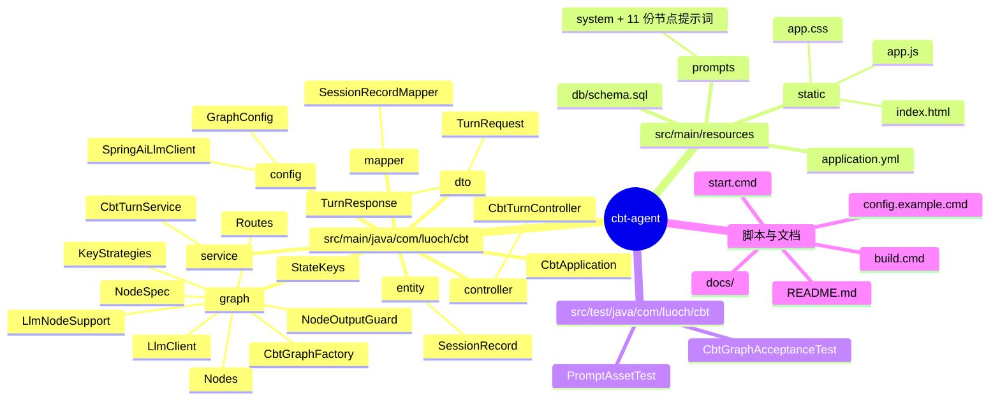
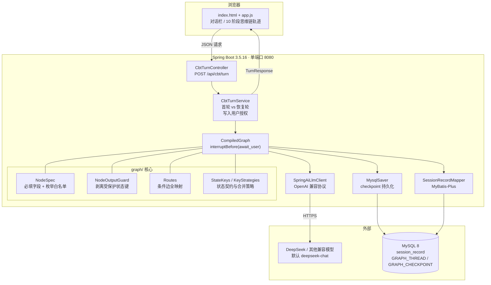
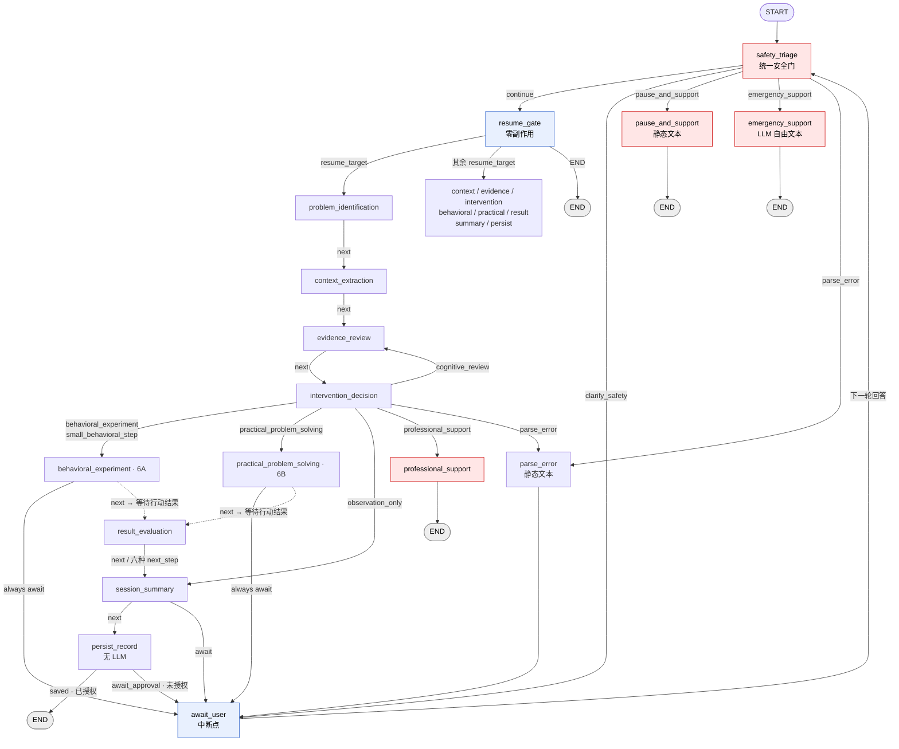
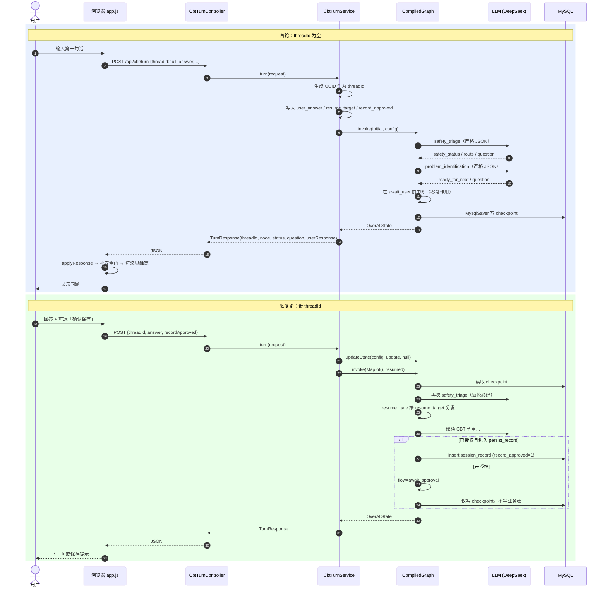
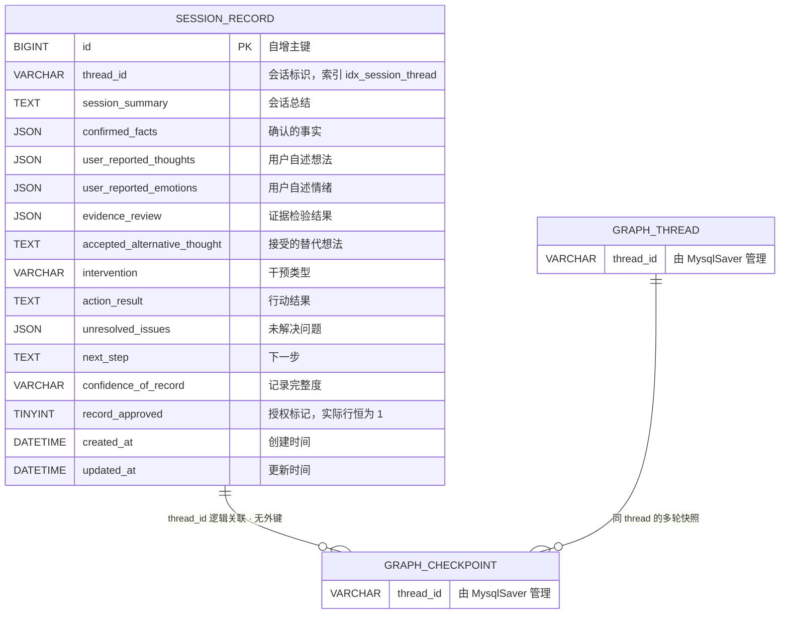
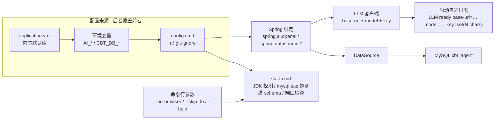
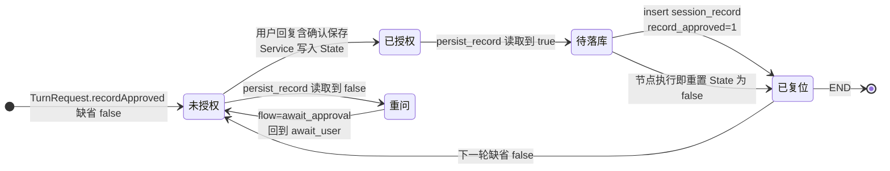
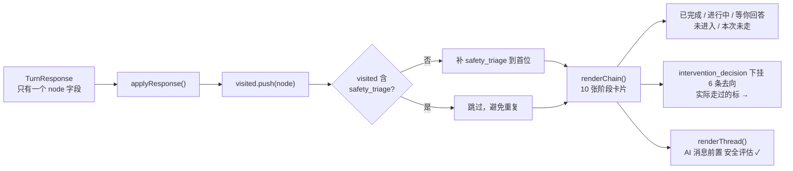

# 架构图表（Mermaid）

本文件的每张图都直接对应当前源码，不画不存在的能力。节点名取自 `Nodes.java`，路由值取自 `Routes.java`，字段取自 `schema.sql`，配置键取自 `application.yml` / `config.example.cmd`。改代码时按文末「维护对照表」同步。

> 渲染：GitHub、GitLab、VS Code（Markdown Preview Mermaid Support）原生支持；无需构建步骤。

---

## 1. 项目结构

要点：

- 后端是标准的 Controller → Service → Graph → Mapper 分层；`graph/` 包是系统的核心，其余包都是它的输入/输出外壳。
- 前端只有 3 个静态文件，随 jar 一起发布，**不是独立前端工程**，没有 npm/CORS。
- `prompts/` 下 11 份提示词由 SHA-256 锁定，测试保证没被改写。

---

## 2. 系统分层架构

读图要点：

| 组件 | 职责边界 |
|---|---|
| `CbtTurnService` | 唯一写入 `record_approved` 的地方；决定 `invoke` 还是 `updateState + invoke` |
| `NodeOutputGuard` | 模型输出里的受保护键一律剥离，模型无法把自己包装成「用户已同意」 |
| `MysqlSaver` | 只管 checkpoint 两张表；业务表 `session_record` 由 Mapper 独占 |
| `SpringAiLlmClient` | 只依赖 OpenAI 兼容协议，换厂家是三个环境变量的事 |

---

## 3. 图状态机（核心逻辑）

关键结构事实：

1. **两条固定边决定安全门的执行时机** — `START → safety_triage` 和 `await_user → safety_triage`。任何一轮都以安全判断开始，无论上一轮停在哪。
2. **`resume_gate` 是恢复分发器** — 10 个 `resume_target` 值（9 个节点 + `END`）全部有映射，穷举由测试 V9 保证。
3. **6A / 6B 永远等待** — `collectAlwaysAwait()` 让 `next` 也指向 `await_user`，因为「计划批准」和「行动结果」都必须由用户带回。
4. **逃生路径结构性不可达** — `pause_and_support` / `emergency_support` / `professional_support` 直接到 `END`，不经过任何 CBT 节点。
5. **未授权保存不是 `END`** — `persist_record` 未授权时回到 `await_user`，让那条待保存记录下一轮仍有机会被确认。

---

## 4. 一轮对话的时序

时序要点：

- `invoke(null, config)` 在 Spring AI Alibaba Graph 1.1.2.0 有重载歧义，恢复必须用 `invoke(Map.of(), resumed)`。
- 授权是**一次性**的：`persist_record` 执行后无论保存与否都把 `record_approved` 重置为 `false`，不会串到下一轮。
- 中断发生在 `await_user` **之前**，所以用户没回答时不会写业务表、不会推进阶段。

---

## 5. 数据模型

数据边界：

| 表 | 归属 | 写入条件 |
|---|---|---|
| `session_record` | `SessionRecordMapper` | 仅当 `record_approved=true` |
| `GRAPH_THREAD` / `GRAPH_CHECKPOINT` | `MysqlSaver` | 每轮中断自动写，`CREATE_IF_NOT_EXISTS` |

`GRAPH_THREAD` 没有时间列；`MysqlSaver.release()` 只置 `is_released=TRUE`，**不删行**。因此 checkpoint 的自动清理是尚未实现的能力，不要假设它会自己过期。

---

## 6. 配置来源与优先级

默认值与覆盖关系：

| 变量 | 默认 | 说明 |
|---|---|---|
| `AI_BASE_URL` | `https://api.deepseek.com` | 只填域名，客户端自动补 `/v1/chat/completions` |
| `AI_MODEL` | `deepseek-chat` | 可换 `deepseek-reasoner` 或任意兼容模型 |
| `DEEPSEEK_API_KEY` | `sk-not-configured` | 占位值让应用无 key 也能启动；此时问答 401 |
| `CBT_DB_PASSWORD` | 空 | 空则 `start.cmd` 交互式提示，不落盘 |

`config.cmd` 优先于环境变量，因为它执行的是 `set`，后赋值覆盖前者。密钥相关文件全部被 `.gitignore` 排除，仓库里只有 `config.example.cmd` 模板。

---

## 7. 保存授权状态机

不可绕过的约束：

1. `record_approved` 在 `StateKeys.PROTECTED` 中，模型输出经 `NodeOutputGuard` 时会被剥离。
2. 唯一写入口是 `CbtTurnService`，且**每一轮都写**（缺席的授权显式重置为 `false`）。
3. `persist_record` 是无 LLM 节点，直接读 State 决定是否 `insert`。
4. 一次授权只对当前轮有效，节点执行后无条件重置。

---

## 8. 前端思维链推导

推导依据与边界：

- `START → safety_triage` 与 `await_user → safety_triage` 是固定边，所以「本轮落在任意 CBT 节点」⇒「安全门必然已过」。前端补首位是**结构性推断，不是伪造轨迹**。
- 接口契约只有 5 个字段（见 `TurnResponse`），没有轨迹数组，所以**中间节点是否被跳过，前端无法知晓**。
- `emergency_support` / `pause_and_support` / `professional_support` / `parse_error` 四个终止节点不在 10 张卡片中；安全门真拦停时左栏不会高亮。完整轨迹需要尚未实现的 `GET /api/cbt/threads/{id}/trace`。

---

## 维护对照表

| 代码变更 | 需同步的图 |
|---|---|
| `Nodes.java` 增删节点 | 图 1、图 3、图 8 |
| `Routes.java` 改路由值 | 图 3、图 4 |
| `schema.sql` 改字段 | 图 5 |
| `application.yml` / `config.example.cmd` 改变量 | 图 6 |
| `CbtTurnService` 改授权写入时机 | 图 4、图 7 |
| `app.js` 改阶段推导 | 图 8 |
